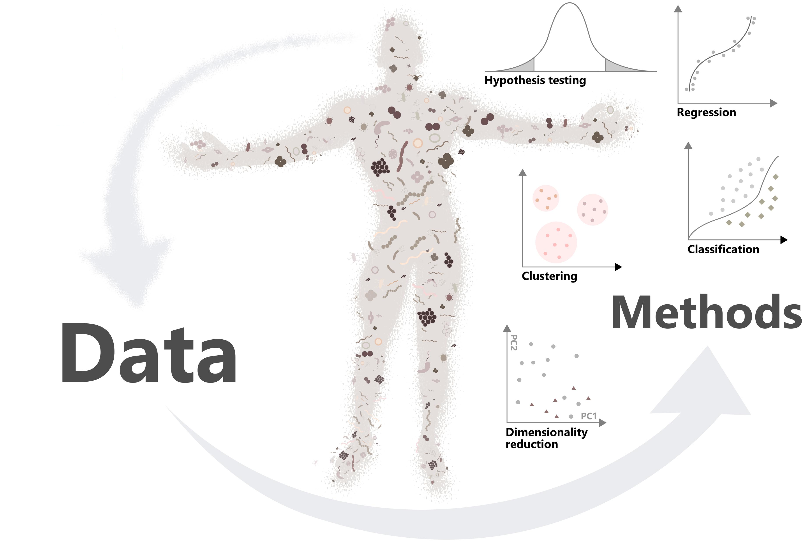

# Welcome {-}

```{r}
#| label: version_line
#| echo: false

# One-line summary of the book version, as in other Bioconductor books
version_line <- tryCatch(
    sprintf(
        "OMA v%s, compiled on %s, using Bioconductor v%s with %s.",
        packageDescription("OMA")$Version,
        format(Sys.Date(), "%d %B %Y"),
        BiocManager::version(),
        sub("^R version ([0-9.]+).*$", "R v\\1", R.version.string)
    ),
    error = function(e) "Local preview."
)
```

*`r version_line`* See [@sec-session-info] for details.

::: {.callout-warning icon='true'}

## Important!

This is a development version of the [**Orchestrating Microbiome Analysis
with Bioconductor**](https://bioconductor.org/books/devel/OMA/) [@OMA] book
from the [OMA microbiome data science framework](https://microbiome.github.io).

:::

You are reading the online book, [**Orchestrating Microbiome Analysis
with Bioconductor**](https://bioconductor.org/books/release/OMA/) [@OMA], where we
walk through common strategies and workflows in microbiome data
science.


The book shows through concrete examples how you can take advantage of
the latest developments in R/Bioconductor for the manipulation,
analysis, and reproducible reporting of hierarchical and heterogeneous
microbiome profiling data sets. The book was borne out of necessity,
while updating microbiome analysis tools to work with Bioconductor
classes that provide support for multi-modal data collections. Many of
these techniques are generic and widely applicable in other contexts
as well.

This work has been heavily influenced by other similar resources, in
particular the Orchestrating Single-Cell Analysis with Bioconductor
[@Amezquita2020], [phyloseq
tutorials](http://joey711.github.io/phyloseq/tutorials-index)
[@Callahan2016] and [microbiome
tutorials](https://microbiome.github.io/tutorials/) [@Shetty2019].
This book extends these resources to teach the grammar of Bioconductor
workflows in the context of microbiome data science.  As such, it
supports the adoption of general skills in the analysis of large,
hierarchical, and multi-modal data collections. We focus on microbiome
analysis tools, including entirely new, partially updated as well as
previously established methods.

This online resource and its associated ecosystem of microbiome data
science tools are a result of a community-driven development process,
and welcoming new contributors. Several individuals have
[contributed](https://github.com/microbiome/OMA/graphs/contributors)
methods, workflows and improvements as acknowledged in
[@sec-contributions]. You can find more information on how to find us
online and join the developer community through the project homepage at
[microbiome.github.io](https://microbiome.github.io). This online
resource has been written in Quarto [@Allaire_Quarto_2022] with the BiocBook
package [@serizay2023].
The material is **free to use** with the [Creative Commons
Attribution 4.0 International (CC BY
4.0)](https://creativecommons.org/licenses/by/4.0/) License.

We assume that the reader is already familiar with R programming. For
references and tips on introductory material for R and Bioconductor,
see [@sec-resources]. The book starts with an *Introduction* to
microbiome data science in Bioconductor. *Data containers* describes the
key data infrastructure, the `TreeSummarizedExperiment` class [@Huang2021] that
provides a container for microbiome data, and how to import and convert
microbiome data sets in the context of this framework. The following
parts cover the common steps in microbiome data analysis, from *Data
wrangling* and *QC & preprocessing* to *Diversity & similarity* and
*Association* analyses, and then progress to more specialized methods
in *Multi-omics* and *ML & AI*. *Training & resources*
provides training material, support channels, further resources and
the list of contributors. Finally, the *Appendices* contain a phyloseq
cheatsheet, a list of related tools, descriptions of the example data
sets, solutions to the exercises and technical information.

::: {.callout-tip icon="true"}

## Extra material

See the [**OMA extras**](https://microbiome.github.io/OMA-extras/) for
additional tutorials and examples, such as
[time series analysis](https://microbiome.github.io/OMA-extras/docs/devel/pages/time_series.html).

:::

## Who this book is for {-}

The book is for researchers and analysts who want to analyse microbiome data
with R and Bioconductor. Basic knowledge of R is helpful; introductory
material is listed in [@sec-training] and [@sec-resources].

## What you will learn {-}

- How to import, store and manipulate microbiome data with the
  `TreeSummarizedExperiment` and `MultiAssayExperiment` [@Ramos2017] data
  containers ([@sec-containers]).
- Common analysis steps, from quality control and transformations to
  diversity, differential abundance, multi-omics and machine learning.
- How to build reproducible analysis workflows in R/Bioconductor.

## What you will not learn {-}

- Processing of raw sequencing reads into abundance tables. The book starts
  from such tables; see [@sec-import] for importing them.
- General introductions to R or statistics; see [@sec-training] and
  [@sec-resources] for related material.

## How to get help {-}

See [@sec-support] for online support, and report problems with the book on
[GitHub](https://github.com/microbiome/OMA/issues).

## Building OMA book {#sec-building-oma}

This book is automatically built to ensure that all code examples are functional.
See [@sec-session-info] for details.

In addition to accessing this book online, you can copy and paste the executable
code examples to run on your local computer. For package installation
instructions, refer to [@sec-packages]. You can also build and view the entire
book locally by following the steps provided
[here](https://github.com/microbiome/OMA?tab=readme-ov-file#deployment), or
use Docker image [@sec-docker-image].
