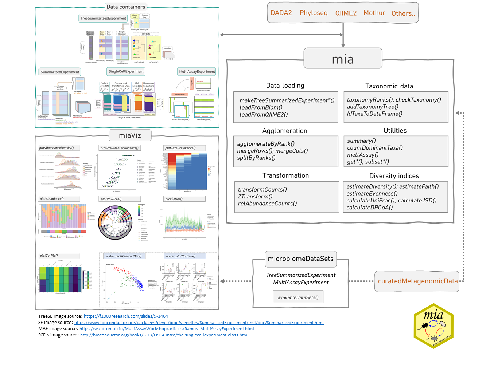

# Getting started {#sec-ecosystem}

```{r}
#| label: setup
#| echo: false
#| results: asis

library(rebook)
chapterPreamble(cache = FALSE)
```

This chapter provides an overview of the OMA ecosystem.
[@sec-data-containers] aims to describe the relationship between data
containers utilized in [OMA](https://microbiome.github.io/). [@sec-packages] details the packages
involved, while [@sec-installation] provides guidance on installing
these packages.

`OMA` (Orchestrating Microbiome Analysis) is an actively developed
R/Bioconductor framework for microbiome downstream analysis. It becomes
particularly relevant when working with abundance tables derived from
sequencing data, whether from shotgun metagenomics or 16S rRNA
sequencing. Before utilizing OMA, sequencing data must undergo
preprocessing to convert raw sequence reads into abundance tables.

`OMA` consists of multiple R/Bioc packages and this online book
that you are reading. The idea is not only to offer tools for microbiome
downstream analysis but also to serve as a resource for valuable
insights, offering guidance on conducting microbiome data analysis and
developing effective microbiome data science workflows.

The key concept of `OMA` lies in its utilization of
`r BiocStyle::Biocpkg("SummarizedExperiment")`-based data containers.
This design choice enhances interoperability and versatility within the broader
Bioconductor framework, facilitating access to an expanding array of
tools. In practice, this approach allows for the integration of
promising methods from related fields, such as single-cell sequencing.

{width="100%"}

## Data containers {#sec-data-containers}

As discussed, `OMA` is built upon
`r BiocStyle::Biocpkg("TreeSummarizedExperiment")` (`TreeSE`) data container.
`TreeSE` is expanded from `r BiocStyle::Biocpkg("SingleCellExperiment")`
(`SCE`) by incorporating additional slots tailored for microbiome analysis.
The `SCE` class is designed for single-cell sequencing
[@R_SingleCellExperiment]. Bioconductor offers wide variety of tools for this
field including online book Orchestrating Single-Cell Analysis in Bioconductor
(OSCA) [@Amezquita2020]. `SCE`, on the other hand, is further derived from
the `r BiocStyle::Biocpkg("SummarizedExperiment")` (`SE`) class.
This hierarchical relationship among data containers means that all methods
applicable to `SCE` and `SE` objects can also be applied to `TreeSE)` objects.

- `r BiocStyle::Biocpkg("SummarizedExperiment")` (`SE`)
[@R_SummarizedExperiment] is a generic
and highly optimized container for complex data structures. It has
become a common choice for analyzing various types of biomedical
profiling data, such as RNAseq, ChIp-Seq, microarrays, flow
cytometry, proteomics, and single-cell sequencing.

- `r BiocStyle::Biocpkg("SingleCellExperiment")` (`SCE`)
[@R_SingleCellExperiment] was developed
as an extension to store copies of data to same data container.

- `r BiocStyle::Biocpkg("TreeSummarizedExperiment")` (`TreeSE`)
[@R_TreeSummarizedExperiment] was developed as an extension to incorporate
hierarchical information (such as phylogenetic trees and sample hierarchies)
and reference sequences.

The relationships between these classes are illustrated in @fig-oma-treese-classes.

```{r}
#| label: fig-oma-treese-classes
#| fig-cap: "SummarizedExperiment (SE) is extended to SingleCellExperiment (SCE), which is further extended to TreeSummarizedExperiment (TreeSE)."
#| fig-width: 4
#| echo: false

library(ggplot2)

p <- ggplot() +
    theme_void() + # Remove axis and background
    annotate("text", x = c(1, 2, 3), y = 1, label = c("SE", "SCE", "TreeSE"), size = 6) +
    annotate(
        "segment",
        x = c(1 + 0.25, 2 + 0.25),
        xend = c(2 - 0.25, 3 - 0.25), y = 1, yend = 1,
        arrow = arrow(length = unit(0.2, "inches"), type = "closed")
    )

p + expand_limits(x = c(0.75, 3.25))
```

`r BiocStyle::Biocpkg("MultiAssayExperiment")` (`MAE`) [@Ramos2017] provides
an organized way to bind several different data containers together in a
single object. For example, we can bind microbiome data (in `TreeSE` container)
with metabolomic profiling data (in `SE`) container, with (partially) shared
sample metadata. This is convenient and robust for instance, in
subsetting and other data manipulation tasks. Microbiome data can be
part of multiomics experiments and analysis strategies. We highlight how
the methods used throughout in this book relate to this data framework
by using the `TreeSE`, `MAE`, and classes beyond.


::: callout-tip
## Other extensions

Beyond `SCE` and `TreeSE`, `SE` has been extended for many other purposes.
Although these extensions were not developed specifically for microbiome data,
they can be useful for it in certain cases. Examples include
`r BiocStyle::Biocpkg("SpatialExperiment")` for
spatially resolved data, `r BiocStyle::Biocpkg("GraphExperiment")` for
graph-structured data, `r BiocStyle::Biocpkg("DeeDeeExperiment")` for storing
differential analysis results, and `r BiocStyle::Biocpkg("ReducedExperiment")`
[@R_ReducedExperiment] for dimensionality reduction results together with
their feature loadings.
These classes build on the same `SE` structure, so the skills covered in this
book carry over to them. You do not need them to follow this book.
:::

## Package ecosystem {#sec-packages}

Methods for the `(Tree)SummarizedExperiment` and `MultiAssayExperiment`
data containers are provided by multiple independent developers through
R/Bioconductor packages. Bioconductor packages include comprehensive manuals
and vignettes that show how to use their methods.

### mia package family

The `r BiocStyle::Biocpkg("mia")` package family provides general methods
for microbiome data wrangling, analysis and visualization.

- `r BiocStyle::Biocpkg("mia")`: Microbiome analysis tools [@R_mia]
- `r BiocStyle::Biocpkg("miaViz")`: Microbiome analysis specific visualization
[@Borman2024]
- `r BiocStyle::Biocpkg("miaSim")`: Microbiome data simulations [@Simsek2021]
- `r BiocStyle::Biocpkg("miaTime")`: Microbiome time series analysis
[@Lahti2021]
- `r BiocStyle::Biocpkg("miaDash")`: Interactive analysis and visualization
[@Benedetti2024miadash]

### Other packages

Many other packages support these data containers, for example for
differential abundance analysis, multi-omics integration and access to
public data. [@sec-tool_list] lists them, together with other microbiome
tools. Tools based on `r BiocStyle::Biocpkg("phyloseq")` can be used by
converting the data with `convertToPhyloseq()`
(see [@sec-conversions-between-data-formats-in-r]). The
[Tools for Microbiome Analysis](https://microsud.github.io/Tools-Microbiome-Analysis/)
site lists more R packages for microbiome data science. Tips on new packages
are [welcome](https://microbiome.github.io).

### Open microbiome data

Hundreds of published microbiome datasets are readily available in these
data containers (see [@sec-example-data]).

## Installation {#sec-installation}

### Specific packages {#sec-packages_specific}

You can install R packages of your choice with the following procedures.

**Bioconductor release version** is the most stable and tested version
but may miss some of the latest methods and updates.

```{r}
#| label: bioc_release
#| eval: false

BiocManager::install("mia")
```

**Bioconductor development version** contains the latest updates. It is
still under development and may require a newer R version. This is primarily
recommended for those who already have experience with R/Bioconductor and need
access to the latest updates.

```{r}
#| label: bioc_devel
#| eval: false

library(BiocManager)
install("mia", version = "devel")
```

**GitHub development version** is usually the same as the Bioconductor
development version. In rare cases, it contains more experimental changes that
are not yet available in Bioconductor.

```{r}
#| label: github
#| eval: false

library(remotes)
install_github("microbiome/mia")
```

### Key packages {#sec-key-packages}

Installing the core packages listed below is sufficient for training
sessions and courses, as they provide the essential functionality
required to run common tasks and most example workflows. You can then
install additional packages as needed, depending on the specific
requirements of your analysis.

Let us first define a script to install packages.

```{r}
#| label: install_function

install_packages <- function(pkg) {
    # Get packages that are already installed installed
    pkg_installed <- pkg[pkg %in% installed.packages()]

    # Get packages that need to be installed
    pkg_to_install <- setdiff(pkg, pkg_installed)

    # Loads BiocManager into the session. Install it if it not already
    # installed.
    if (!require("BiocManager")) {
        install.packages("BiocManager")
        library("BiocManager")
    }

    # If there are packages that need to be installed, installs them with
    # BiocManager.
    if (length(pkg_to_install) > 0) {
        install(pkg_to_install, ask = FALSE)
    }

    # Load all packages into session. Stop if there are packages that were not
    # successfully loaded.
    pkgs_not_loaded <- !sapply(pkg, require, character.only = TRUE)
    pkgs_not_loaded <- names(pkgs_not_loaded)[pkgs_not_loaded]
    if (length(pkgs_not_loaded) > 0) {
        stop(
            "Error in loading the following packages into the session: '",
            paste0(pkgs_not_loaded, collapse = "', '"), "'"
        )
    }
    return(TRUE)
}
```

The core packages include `r BiocStyle::Biocpkg("mia")`,
`r BiocStyle::Biocpkg("miaViz")`, `r BiocStyle::Biocpkg("maaslin3")`
(for differential abundance), and `r BiocStyle::CRANpkg("mikropml")`
(for supervised ML).

```{r}
#| label: install_key_packages

pkgs <- c("mia", "miaViz", "maaslin3", "mikropml")
install_packages(pkgs)
```

### All packages

You can install all packages that are required to run every example in
this book via the following command:

```{r}
#| label: install_packages
#| eval: false

library(remotes)
install_github("microbiome/OMA", dependencies = TRUE, upgrade = TRUE)
```

Optionally, you can install all packages or just certain ones with the
following script.

```{r}
#| label: all_packages
#| eval: false

# URL of the raw CSV file on GitHub. It includes all packages needed.
url <- "https://raw.githubusercontent.com/microbiome/OMA/devel/oma_packages/oma_packages.csv"

# Read the CSV file directly into R
df <- read.csv(url)
packages <- df[[1]]

# Install packages
install_packages(packages)
```

### Docker container

Installing all the packages might take some time, and sometimes there
can be some troubles. To get quickly access to all packages, you might
want to consider loading the Docker image. You can find more information
from [@sec-docker-image].

### Troubleshooting

If you encounter installation issue related to package dependencies
please see the troubleshoot page
[here](https://github.com/microbiome/OMA/blob/devel/PackageInstallations_Troubleshoots.qmd)
and [@sec-support].

## Colours in figures {#sec-figure-colours}

The figures in this book use colour-blind-friendly palettes: the Okabe-Ito
palette [@Okabe2008] for groups and viridis for continuous values. These are
set as the defaults with `ggplot2` options, which the plotting functions of
`r BiocStyle::Biocpkg("miaViz")` also follow. You can use the same palettes in
your own analysis by running the following before plotting:

```{r}
#| label: figure_colours
#| eval: false

pal <- palette.colors(palette = "Okabe-Ito")[-1]
options(
    ggplot2.discrete.colour = pal,
    ggplot2.discrete.fill = pal,
    ggplot2.continuous.colour = "viridis",
    ggplot2.continuous.fill = "viridis"
)
```

The Okabe-Ito palette has eight colours. When a figure shows more groups,
`r BiocStyle::Biocpkg("miaViz")` uses its own, larger palettes instead, and
plots from other packages, such as `r BiocStyle::Biocpkg("scater")`, may use
their own palettes. The code in the book is highlighted with the accessible
a11y theme.

## Interactive analysis {#sec-webapp}

We also provide the Microbiome Analysis Dashboard
(`r BiocStyle::Biocpkg("miaDash")`), a web app to interactively explore
microbiome data through an intuitive Graphical User Interface (GUI).
The app features a large part of the `r BiocStyle::Biocpkg("mia")`
functionality and does not require any knowledge of R programming. This
way, beginners can practice and learn the concepts of microbiome analysis
while free from technical burdens. The app is openly available on Galaxy
at [this address](https://usegalaxy.eu/?tool_id=interactive_tool_miadash).
Feature requests and bug reports can be submitted
[here](https://github.com/microbiome/miaDash/issues/).

::: callout-tip
## Summary

- `r BiocStyle::Biocpkg("TreeSummarizedExperiment")` is derived from
`r BiocStyle::Biocpkg("SummarizedExperiment")` class.
- [OMA](https://microbiome.github.io/) is based on
`TreeSummarizedExperiment` data container.
- We can borrow methods from packages utilizing
`r BiocStyle::Biocpkg("SingleCellExperiment")` and `SummarizedExperiment`.
:::

::: {.callout-tip icon="false"}
## Exercises

**Goal:** Learn related packages and resources.

**Exercise 1: Introduction to OMA**

1. How are `SummarizedExperiment`, `SingleCellExperiment` and
`TreeSummarizedExperiment` related?

2. Go and explore
[this CSV file](https://raw.githubusercontent.com/microbiome/OMA/devel/oma_packages/oma_packages.csv).
Which packages have you already used? Which packages are new to you?

3. Search each package from internet. What tools does each package offer?

4. Go to [the discussion forum](https://github.com/microbiome/OMA/discussions).
Here you can get help and ask questions if you come up with one.

5. Visit [@sec-resources] for additional resources.
:::
